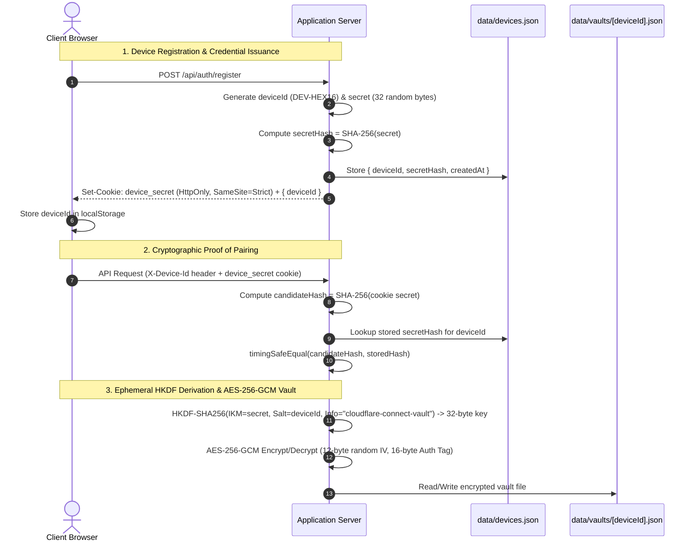

# Architecture & Security Design

This document details the credential management, device pairing, and cryptographic architecture of the Cloudflare Pages Deployment Dashboard.

## Threat Model & Design Goals

The application is designed for single-tenant local or self-hosted deployment. Its architecture satisfies the following operational goals:

1. **Credential Isolation**: Cloudflare API tokens are never exposed to client-side scripts, never transmitted in API responses, and never logged in server telemetry.
2. **Device-Specific Vaults**: Different browser sessions can manage their own distinct Cloudflare credentials through isolated encrypted vaults.
3. **Headless & CLI Compatibility**: When no browser vault is paired, the server falls back to environment variables defined in `.env` for CLI workflows and automated tasks.
4. **Defense in Depth**: Ephemeral key derivation, authenticated encryption, constant-time validation, and multi-tier rate limiting protect server-side endpoints.

## Authentication & Device Pairing Protocol

The application does not implement a multi-user identity provider or role-based access control (RBAC). Instead, it implements a stateless cryptographic device pairing protocol that binds a specific client browser to server-side encrypted credentials.



### Protocol Mechanics

1. **Dual-Factor Split Possession**:
   - **Public Identifier (`X-Device-Id`)**: An 18-character identifier (`DEV-[A-Z0-9]{16}`) generated on the server, stored in client `localStorage`, and transmitted via the `X-Device-Id` HTTP header.
   - **Secret Proof (`device_secret`)**: A 256-bit cryptographically secure random value (`crypto.randomBytes(32)`) issued as an `HttpOnly`, `SameSite=Strict` cookie. Because the cookie is marked `HttpOnly`, it cannot be accessed or exfiltrated by client-side JavaScript.
   - API endpoints require both factors to match before processing requests.

2. **Server-Side Secret Hashing at Rest**:
   - The server never stores the raw `device_secret` on disk.
   - Only `SHA-256(device_secret)` is persisted in `data/devices.json`. In the event of a disk read exposure or unauthorized file inspection, the stored hash cannot be reversed to obtain the key material needed to decrypt the user's credential vault.

3. **Constant-Time Comparison**:
   - Candidate secret hashes are compared against stored hashes using `crypto.timingSafeEqual` to eliminate timing side-channel attacks.

4. **Brute-Force & Abuse Mitigation**:
   - Unauthenticated endpoints are limited to 30 requests per minute per IP.
   - Five consecutive failed authentication attempts from an external IP trigger an automated 15-minute lockout. Loopback interfaces (`127.0.0.1`, `::1`) are exempt to prevent developer lockout during local restarts.
   - The Cloudflare Connect endpoint enforces a maximum of 5 connection attempts per minute per device.

## Credential Storage & Encryption

The application maintains a two-tier credential resolution hierarchy:

```
Request Resolution Order:
1. Per-Device Encrypted Vault (data/vaults/<deviceId>.json)
2. Server Environment Fallback (.env)
```

### Tier 1: Per-Device Vault

When connecting through the dashboard wizard:
- The server verifies the token and auto-detects the Account ID using the Cloudflare REST API.
- An ephemeral 256-bit encryption key is derived using HKDF (RFC 5869) with SHA-256:
  - **Input Key Material (IKM)**: `device_secret` (from the verified `HttpOnly` cookie)
  - **Salt**: `deviceId`
  - **Info**: `"cloudflare-connect-vault"`
  - **Length**: 32 bytes
- The credentials are encrypted with **AES-256-GCM** using a unique 12-byte initialization vector (IV) and a 16-byte authentication tag.
- The ciphertext, IV, and authentication tag are stored in `data/vaults/<deviceId>.json`.
- Any modification or byte tampering invalidates the authentication tag, causing decryption to fail and refusing access.

### Tier 2: Server Environment Fallback

If a request arrives from a client without a Tier 1 vault, or during CLI operations:
- The server reads `CLOUDFLARE_API_TOKEN` and `CLOUDFLARE_ACCOUNT_ID` from `.env`.
- This ensures terminal commands (`npm run status`, `npm run deploy:random`) function without requiring an active browser pairing.

## Deployment Isolation & File Filtering

1. **Wrangler Execution**:
   - The Wrangler CLI is executed as a child process with Cloudflare credentials injected strictly via process environment variables (`CLOUDFLARE_API_TOKEN`, `CLOUDFLARE_ACCOUNT_ID`).
   - Credentials are never passed as command-line arguments, preventing exposure in process listings (`ps`, Task Manager).
   - Real-time logging pipes sanitize any token occurrences before transmitting output to the client interface.

2. **Upload Sanitization**:
   - Uploaded file paths are validated against path traversal (`..`), absolute paths, and null bytes.
   - Sensitive file patterns are blocked at any directory depth during staging, including `.env*`, `.git/`, `.aws/`, `*.pem`, `*.key`, `id_rsa*`, and `.npmrc`.
